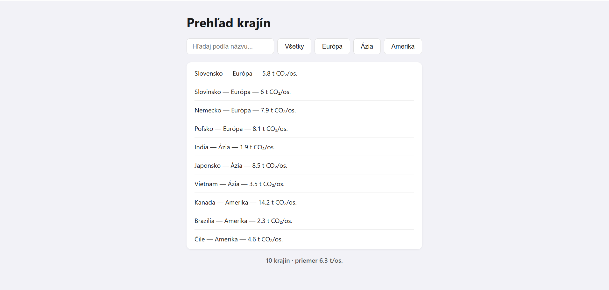

# Prehľad krajín

Interaktívna stránka na vyhľadávanie a filtrovanie krajín podľa kontinentu, s prehľadom emisií CO₂.

🔗 **Živá stránka:** https://jakubjalcak1.github.io/prehlad-krajin/

## Čo sa na stránke dá robiť

- Vyhľadať krajinu podľa názvu (nerozlišuje veľké/malé písmená)
- Filtrovať podľa kontinentu (Všetky / Európa / Ázia / Amerika)
- Obe filtrovania fungujú súčasne
- Pod zoznamom je súhrn — počet zobrazených krajín a priemer ich emisií CO₂ na osobu

## Ako to spustiť

Stránka nepotrebuje žiadny server ani inštaláciu — stačí otvoriť `index.html` v prehliadači, alebo použiť živý odkaz vyššie.

## Čo je v ktorom súbore

- `index.html` — kostra stránky (input, tlačidlá kontinentov, kontajnery na zoznam a súhrn)
- `data.js` — dáta o krajinách (pole objektov)
- `app.js` — vykresľovanie zoznamu, filtrovanie a súhrn
- `styles.css` — vzhľad stránky

## Čo by som dorobil

- Tlačidlo na zoradenie krajín podľa emisií (vzostupne/zostupne)
- Farebné odlíšenie riadku so súhrnom